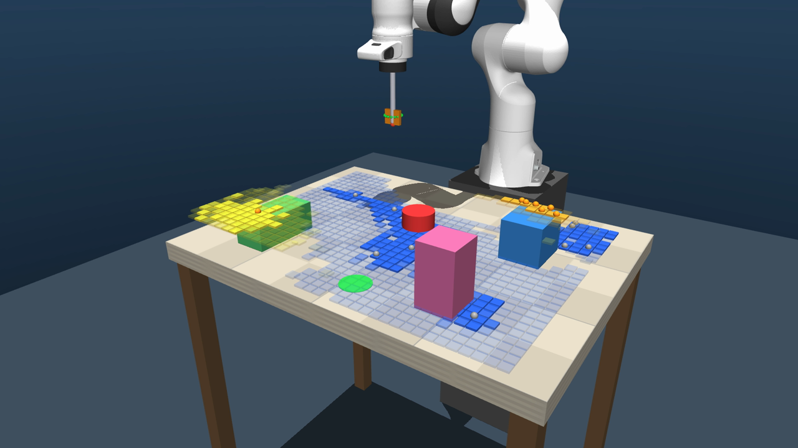
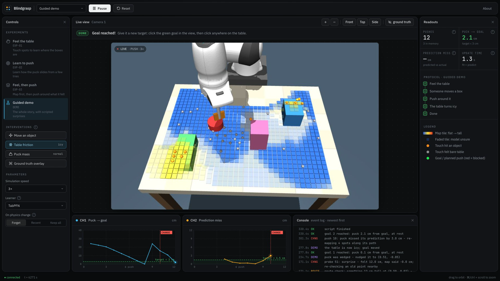
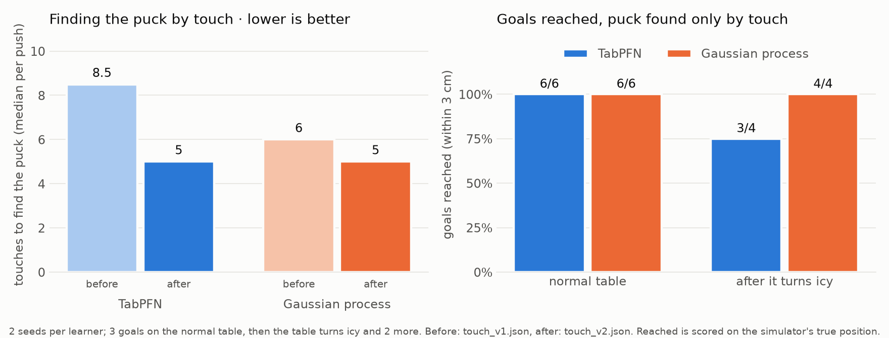
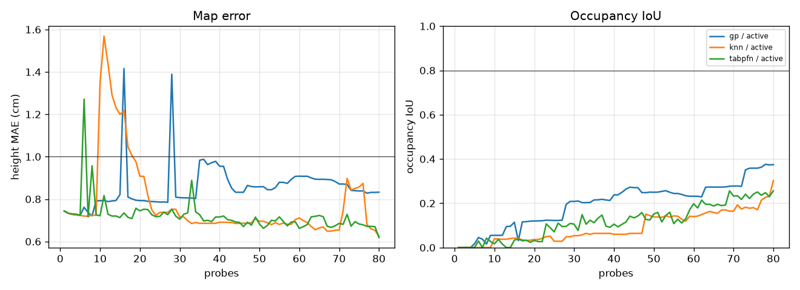
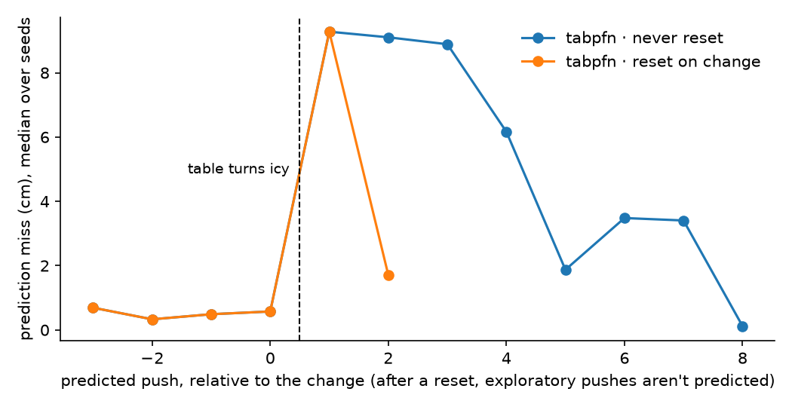
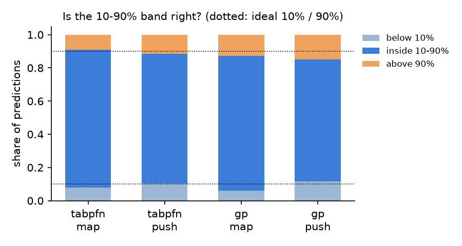

# Blindgrasp

A blind Franka Panda arm in MuJoCo maps its table by touch, then pushes a puck to a goal around the
boxes it found. TabPFN is the only learner and never takes a gradient step: every probe and every push is
a new row in its context. See `Build Plan.md` for the full plan.

<p align="center"></p>

## The story

**You can find your keys at the bottom of a bag without looking. Robots can't.** Picking robots in warehouses rely on
depth cameras, and those cameras miss things: clear and shiny packaging (light passes through it or bounces off it;
lasers are light too), items at the bottom of a deep tote, and whatever the gripper itself is covering. And every new
item slides differently when pushed (polybag, cardboard, glossy box), while learned pushing methods train for hours
by trial and error, once, not per item.

Blindgrasp is that problem in miniature: a Franka Panda in MuJoCo with no camera, whose only sense is a probe that
touches the table and reports a height. The goal is given as the task and the robot is told where the puck starts;
everything else, including where the puck went after each push, it finds by touch. The table is the tote or shelf, the
boxes are the other items, the puck is the item to slide into a graspable spot, and the icy table is a new item in
slippery packaging. We built it with no camera at all to show the hardest case; with a camera, touch becomes the check
where the camera is unsure. The same need shows up wherever cameras fail: home robots reaching into cupboards, murky
water, and at the extreme, nuclear cleanup, where robots at Fukushima lost their cameras to radiation and operators
touched debris to test whether it could be moved.

**1. Map the table by touch.** Every touch becomes one row in TabPFN's context (`x, y, height`). TabPFN is a foundation
model for tables: it never trains, so the very next prediction already uses the new row. Its 10-90% band says where the
map is unsure, and the arm always touches the least certain spot next. Within a few dozen touches the boxes appear.

<p align="center"></p>

**2. The world changes.** A presenter moves a box onto the puck's route. The map still says the route is clear; a map
is only as fresh as its last touch. So before every push the arm touches a few spots on the route, feels something
12 cm tall where the map said empty, re-touches an old spot to make sure it is a real change and not noise, drops the
stale rows and plans around the box.

<p align="center"></p>

**3. Push the puck to the goal, in a few tries.** Pushing is learned the same way: each strike (speed,
follow-through, where the puck stopped) is one more row. The robot can't see where the puck stopped, so after every
push it feels for it where TabPFN predicts it went: the puck slides almost straight along the push line, so a few
touches along that line pin it down to a couple of millimetres. The better the prediction, the fewer touches. Then the
table turns icy. The puck isn't where predicted, the robot finds it further along the line, treats the 10 cm miss as a
physics change, drops its old pushes and is back on target two to three pushes later.

<p align="center"></p>

**4. Watch it live in the browser.** A lab-workstation UI streams the simulation and lets you run the experiments,
move objects, change the table's friction and follow the map, the charts and the event log.

<p align="center"></p>

## Evaluation

Measured with the scripts under `eval/` (3 seeds each; numbers and plots in `eval/out/`, copies in `docs/eval/`).

<p align="center"></p>

- **Mapping (80 touches):** TabPFN's height error (0.62 cm) beats the Gaussian process (0.83 cm) and ties nearest
  neighbours. Each touch is accurate to about 1 mm. A re-run on another machine (3 seeds) gave TabPFN 0.55 cm,
  kNN 0.59, GP 0.77: same ranking.
- **Pushing:** TabPFN reaches the goal in a median of 4 pushes from an empty context (GP 5), and 2.5 after the table
  turns icy (GP 3). All 9 + 6 goals were reached.
- **The limit:** box outlines (occupancy IoU) are no better than the GP's. With 80 touches every learner sits near the
  same ceiling: the number of touches, not the learner, is the limit.

**Finding the puck by touch** (`eval.push_eval --sense touch`, 2 seeds per learner: 3 goals on the normal table, then
the table turns icy and 2 more; "reached" is scored on the simulator's true position, which the robot never reads):

<p align="center"></p>

- **About 4-5 touches per push:** median 5 for both learners (before the search and planner changes: TabPFN 8.5,
  GP 6); after the three seed pushes, about 4. The touch estimate is within 2 mm of the true position (median).
- **All 12 goals on the normal table reached** with the puck found only by touch.
- **After the table turns icy:** TabPFN flags the change in every run with no false alarms (GP: 1 of 2) and is back on
  target in a median of 2.5 pushes (GP 3.5); it reached 3 of 4 icy goals, the GP 4 of 4 (was 2 and 1 of 4).
- Short runs (2 seeds): read them as indicative, not final.

| Map error and box outlines vs touches | After a box is moved (red line) |
|---|---|
|  |  |

| Change detection on the icy table | Is the uncertainty band honest? |
|---|---|
|  |  |

Resetting the push context on a detected change brings the prediction miss back down within 2 pushes; keeping the old
pushes takes 5-8. The 10-90% bands hold 73-83% of outcomes (ideal: 80%) for both learners, so "least certain" is a fair
guide for where to touch next.

## For the pitch deck and video

Use these when building the slides and the film (`pitch/`). Every number here is measured in this repo or sourced.

**The use case in one line.** *"Blindgrasp lets a robot work by touch when its camera fails, learning how a new item
slides from three pushes, with no training."* Lead with warehouse picking; keep nuclear cleanup to one closing sentence.

| In the demo | In a warehouse |
|---|---|
| Table | Tote or shelf |
| Boxes | Other items in the way |
| Touch map | Feeling what's in the tote when the camera can't |
| Pushing the puck | Sliding an item into a graspable spot |
| Icy table | A new item in slippery packaging |

**Why vision isn't enough (one slide).** Google's ClearGrasp study (ICRA 2020): glass bottles did not show up in a
standard RealSense depth image at all; a robot picking transparent objects succeeded **12%** of the time with a
parallel-jaw gripper (74% after their fix), and the fix needed a network trained on **50,000+** synthetic images.
Sources: [Google Research blog](https://research.google/blog/learning-to-see-transparent-objects/),
[paper](https://arxiv.org/abs/1910.02550). Learned pushing (e.g. [Zeng et al. 2018](https://arxiv.org/abs/1803.09956))
trains for hours by trial and error.

**"Why not a camera or a laser?"** (the judges will ask). Don't argue against cameras: touch is the check, not the
replacement. Cameras and lasers both use light, and fail on (1) what's hidden: the bottom of a tote, inside a cupboard,
under the gripper; (2) clear, shiny or dark materials, steam, dust, smoke; (3) what things are like: solid, stuck or
slippery is only learned by touching. Blindgrasp touches only where it's unsure (TabPFN's uncertainty band picks the
spot) and re-checks the route before acting, because a map is only as fresh as its last look. Ready answer: *"We'd use
a camera when it works. Blindgrasp is for the moments it doesn't: the item is hidden, it's clear or shiny, or you need
to know whether it will move. Then the robot touches only where it's unsure, and learns from every touch without
training."*

**Closing line (optional).** At Fukushima Daiichi, robots lost their cameras to radiation and humidity, and in 2019
TEPCO had a remote device touch debris at 6 spots to test whether it could be moved (5 could):
[TEPCO](https://www.tepco.co.jp/en/hd/newsroom/reports/archives/2019/investigation-confirms-movability-of-some-deposits.html),
[IEEE Spectrum](https://spectrum.ieee.org/robot-stranded-inside-fukushima-nuclear-reactor).

**Numbers to use**

| Claim | Number | Source |
|---|---|---|
| Map height error after 80 touches | TabPFN 0.55 cm vs GP 0.77 cm (kNN 0.59) | `eval.map_eval`, 3 seeds |
| Touches to find the puck after a push | about 4-5 (median 5; was 8.5) | `eval.push_eval --sense touch`, 2 seeds |
| Puck position from touch | within 2 mm (median) | same |
| Icy change detected | every run, no false alarms (TabPFN) | same |
| Back on target after the change | 2-3 pushes | same |
| Training steps | 0: every touch and push is a new row in TabPFN's context | by design |

**Charts and media**

- `docs/eval/summary.png`: map error and pushes to the goal, TabPFN vs baselines.
- `docs/eval/touch_search.png`: finding the puck by touch, before/after, and goals reached by touch only.
- `docs/eval/push_icy_misses.png`: the prediction miss spikes when the table turns icy and recovers in 2 pushes.
- `docs/media/*.gif`: mapping, route check, icy push. New footage: `eval/render_clips.py --mode push` now shows the
  touch search (orange dots = touched the puck, grey = bare table, cyan ring = where the robot believes the puck is).

**Be honest about**

- Box outlines (IoU) are not a TabPFN win: every learner sits near the same ceiling at 80 touches.
- After the table turns icy, the GP reached 4 of 4 goals and TabPFN 3 of 4. TabPFN's edge there is detecting the change
  (every run, no false alarms) and recovering in fewer pushes.
- This is a simulation; the warehouse and Fukushima are the motivation, not claims about deployed systems.

## Setup

```bash
uv venv --python 3.11 .venv
uv pip install --python .venv/bin/python -r requirements.txt
git clone --depth 1 --filter=blob:none --sparse https://github.com/google-deepmind/mujoco_menagerie.git
(cd mujoco_menagerie && git sparse-checkout set franka_emika_panda)
.venv/bin/python assets/build_panda_probe.py        # Panda + probe rod + push paddle -> assets/panda_probe.xml
cp .env.example .env                                # then put your Prior Labs key in .env (never in .env.example)
```

TabPFN needs `TABPFN_TOKEN` in `.env` for both paths:
- **local** weights (TabPFN 3.5, ~835 MB): accept the license once at
  `https://ux.priorlabs.ai/accept-license?hf_repo_id=tabpfn_3_5`; the weights download on first use.
- **hosted** API (`tabpfn-client`): metered, with a daily token cap that resets at 00:00 UTC.

`src/config.py` picks the backend: `BLINDGRASP_BACKEND=local|hosted` and `BLINDGRASP_DEVICE=cpu|mps|cuda`
override the default (local if a CUDA/MPS GPU exists, else hosted).

## Run the demo (browser)

Two processes: the Python sim server (physics, robot, TabPFN, video stream) and the Next.js UI.

```bash
.venv/bin/python -m src.web.server --mode script --learner tabpfn   # sim server on http://127.0.0.1:8000
cd web && npm install && npm run dev                                 # UI on http://localhost:3000
```

Open http://localhost:3000. The UI talks to the sim server at `NEXT_PUBLIC_SIM_URL` (default
`http://127.0.0.1:8000`); it reconnects on its own if the server restarts. If a static export of the UI exists
(`cd web && npm run build` -> `web/out`), the sim server also serves it at http://127.0.0.1:8000; otherwise it serves
the old single-file page there.

| `--mode`   | What it shows |
|------------|---------------|
| `map`      | Act 1: probe the most uncertain spot, map sharpens; move a box and it re-maps |
| `push`     | Act 2: few-shot pushing; make the table icy (F) and it re-adapts in a few pushes |
| `combined` | Acts 1 + 2: map, then push around the boxes the map found |
| `script`   | Presenter mode: the combined run with fixed seeds and scripted interrupts |

Learner: `--learner tabpfn|gp|knn|mlp` (also switchable in the page). For TabPFN on a laptop use the
slow-learner settings: `--n-estimators 1 --pred-step 0.04` (1-model ensemble, map predicted on a 4 cm grid
and upsampled). `--max-rows N` caps the context. `--speed` sets sim seconds per wall second.

The page is a dark lab-workstation layout: the live view in the middle, and three panels that start closed as
rails on the edges (Controls: experiments, interventions, parameters; Readouts: numbers, protocol, legend; Charts &
log). Open the ones you want; the choice is remembered. The top bar has the experiment picker, Run/Pause and Reset.
In the view: drag to orbit, Ctrl/⌘ + scroll (or the +/− buttons) to zoom, "Move an object" then click a box/puck/goal
and then the table to move it (Esc cancels). Interventions: table friction (normal / icy / sticky), puck mass,
ground-truth overlay.

The native MuJoCo viewer also works (`.venv/bin/mjpython -m src.demos.touch_map`; F6-F10 keys), but the
browser viewer is the main one.

## Tests and evaluation

```bash
.venv/bin/python -m eval.phase1_check                           # 100 probes vs ray cast, 100 pushes (no flips / arm hits)
.venv/bin/python -m bench.tabpfn_latency --backends local:cpu hosted --n-estimators 1 8
.venv/bin/python -m eval.map_eval --learners tabpfn gp knn mlp --strategies active random raster --seeds 10
.venv/bin/python -m eval.map_eval --recovery                     # move the best-mapped box mid-run
.venv/bin/python -m eval.push_eval --learners tabpfn gp knn --adapt reset window none --seeds 10
.venv/bin/python -m eval.push_eval --learners tabpfn gp --sense touch --seeds 2 --change friction low --tag touch_v2
.venv/bin/python -m eval.touch_chart eval/out/touch_v1.json eval/out/touch_v2.json   # docs/eval/touch_search.png
```

`--sense touch` is the real setting: the robot finds the puck by touch after every push. `--sense oracle` (default)
reads its position from the simulator, which is faster for comparing learners. Run TabPFN evals one at a time on a
small GPU: parallel runs can run out of GPU memory (the eval now stops with an error instead of scoring it as a miss).

Outputs go to `bench/out/` and `eval/out/` (tables, JSON, plots). `python -m eval.summary_chart` redraws the README chart;
`python -m eval.render_clips --mode script|map|push --clean --views front,hero` renders MP4s offline (deterministic per
seed; use `BLINDGRASP_BACKEND=local` to keep hosted TabPFN tokens).

## Layout

```
assets/        scene.xml (table, boxes, puck, goal), build_panda_probe.py -> panda_probe.xml
src/config.py  .env loading, backend/device choice, regressor factory (local or hosted)
src/sim/       env.py (scene, contacts, ground truth, friction/mass), controller.py (mink IK),
               primitives.py (probe_down, push as step-wise generators)
src/learn/     tabpfn_service.py (TabPFN, context tables, background fit thread), baselines.py (GP, kNN, MLP)
src/demos/     touch_map.py (Act 1), push.py (Act 2), puck_search.py (find the puck by touch after a push),
               combined.py (1 + 2), script.py (presenter mode)
src/viz/       overlay.py (map tiles, probe dots, push path)
src/web/       server.py (sim server: MJPEG /stream, /state, /action; serves web/out if built) + static/index.html
web/           Next.js UI (src/components/Dashboard.tsx, Viewport.tsx, LineChart.tsx; src/lib/sim.ts = API client)
bench/ eval/   latency benchmark, Phase 1 acceptance, map and push evaluations, render_clips.py (offline MP4s),
               summary_chart.py (docs/eval/summary.png), touch_chart.py (docs/eval/touch_search.png)
docs/          README screenshots, GIFs and evaluation charts
```

## Findings so far (see the build plan for targets)

- Reach: the arm can't reach the plan's far table edge; probes/pushes use a tested workspace
  (box x 0.20-0.72 m, |y| <= 0.35 m, 0.32-0.80 m from the base).
- Probe accuracy: within 1.1 mm of the surface; edge contacts are reported at the contact point.
- The 6 mm tip footprint dilates every box by ~6 mm; even probing every cell caps geometric IoU near 0.78,
  so map IoU is scored against what a probe would feel ("touch truth"), with geometric IoU reported too.
- Pushes are strikes (paddle speed at contact + follow-through): slow position-controlled pushes made the
  puck's travel independent of friction and mass, leaving nothing to learn and no change to detect.
- A probe that contradicts the map is verified by re-touching an old spot before any data is dropped.
- Identical pushes repeat to < 1 mm (3 mm at full speed), so push-to-push variation came from the planner: it drew a
  new random speed, follow-through and offset each time and, with the goal out of reach, chose the push with the most
  optimistic predicted slide. Now pushes are centred on the puck (the offset changed the slide by < 3 mm), the planner
  prefers confident predictions (kappa = 1) and the seed pushes are a fixed slow / medium / fast set. GP, simulator
  positions, 4 seeds: median prediction miss 0.38 -> 0.14 cm, worst 10% 1.4 -> 0.4 cm. The push direction changes the
  slide by about 10% (the arm's joints move differently), but as an extra input it made predictions worse with this
  little data (`DIR_FEATURE`, off).
- Finding the puck: it moves almost straight along the push line (sideways < 1.5 cm), so the search is mostly 1-D along
  that line, trusting the push model's sideways prediction (5 mm floor).
- TabPFN backend (`bench/out/latency.md`): local CPU, 1-model ensemble, coarse grid = 0.4-0.75 s per update.
  Apple GPU and the hosted API (~2.6 s/call) are slower on this laptop.
- Mapping, 3 seeds x 80 probes (`eval/out/map_*.json`): TabPFN's height error (0.5-0.7 cm, mean 0.62) beats the GP
  (mean 0.83) and ties kNN (0.62), but it outlines boxes no better than GP (IoU 0.26-0.33 vs 0.37). Bigger ensembles, the full grid and the
  boundary-tracing strategy didn't change that much; neighbour features (`--learner tabpfn_nn`) help a little.
  Every learner sits near the ~0.37 ceiling for this many probes: probe count, not the learner, is the limit.
- Combined run: before each push the arm touches up to 3 unchecked spots on the puck's route (the map is only as
  fresh as its last touch: a box may have moved). Anything touched tall blocks paths straight away, whatever the
  learned map says. This is how the presenter-mode box move onto the route gets found and avoided.
- Puck mass doesn't matter for these pushes (< 0.6 cm change): the paddle is position-controlled and a sliding
  puck's stopping distance doesn't depend on mass. Use the icy table as the Act 2 interrupt.
- Pushing, 3 seeds (9 goals): TabPFN reaches goals in a median of 4 pushes from an empty context (GP 5), 2-3 after the
  table turns icy. The single-goal push demo (`--mode push`) has a longer first shot (~22 cm) and takes 6-7.
